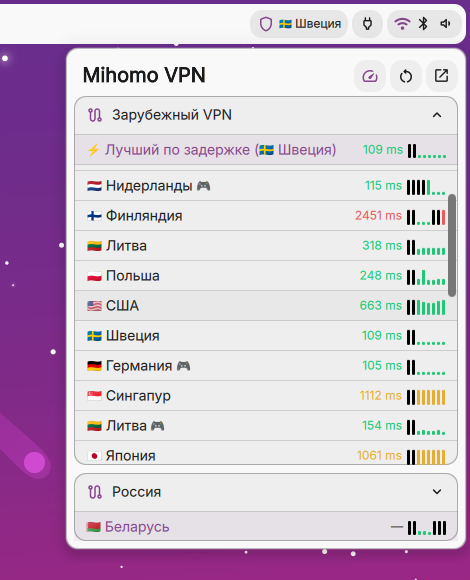

# Mihomo DMS Widget

A compact [DankMaterialShell (DMS)](https://github.com/AvengeMedia/DankMaterialShell)
widget built with [Quickshell](https://quickshell.org/) for the system
[Mihomo](https://github.com/MetaCubeX/mihomo/tree/Alpha) service. It presents
selected proxy groups, supports quick node switching, runs latency probes, and
opens a configured [MetaCubeXD](https://github.com/MetaCubeX/metacubexd)
dashboard.



## Features

- Refresh Capybara through the optional [Rust updater](updater/README.md), with
  error notifications and a persistent red indicator, even with VPN off.

- Select any number of Mihomo `Selector` groups and drag enabled groups in
  settings to arrange their widget order. Disabled groups appear at the bottom.
- Optionally enable VPN when the widget loads (including shell restarts and
  plugin reloads). `Enable VPN on startup` defaults to off and runs only once
  per widget instance; manually turning VPN off is respected until the next load.
- Expand multiple groups at the same time.
- Display the active node, recent latency history, and probe status.
- Scroll long node lists while keeping the popout within the screen bounds.
- Switch nodes and probe all visible groups through the local controller API.
- Persist VPN ON/OFF across Wi-Fi, resume and service restarts using the local
  [Rust controller](updater/README.md#local-vpn-control).
- Open a configured MetaCubeXD dashboard directly from the widget.
- Preserve expanded groups and scroll positions across periodic API refreshes.

## Known limitation

In DMS connected frame mode, very rapid clicks while the popout is resizing can
occasionally be interpreted as an outside click and dismiss the popout.

## Requirements

### Runtime

- [DankMaterialShell (DMS)](https://github.com/AvengeMedia/DankMaterialShell)
  1.5.0 or newer. DMS provides the Quickshell and Qt 6 runtime used by the
  widget.
- A running [Mihomo](https://github.com/MetaCubeX/mihomo/tree/Alpha) instance.
- Mihomo's
  [external controller REST API](https://wiki.metacubex.one/en/config/general/#external-control-api)
  reachable at `http://127.0.0.1:9090` with an empty API secret:

  ```yaml
  external-controller: 127.0.0.1:9090
  secret: ""
  ```

- `curl` and `jq` available on `PATH`.
- `pkexec`, systemd, and the installed `mihomo-vpn-control` helper for durable
  mode changes and starting/restarting the service.

The external controller is built into Mihomo. This widget and MetaCubeXD are
independent clients of that API: the widget connects directly to Mihomo, while
MetaCubeXD provides the optional full dashboard.

The VPN switch invokes the restricted local helper, which uses systemd and
preserves the saved mode. It writes `mode` atomically to
`/etc/mihomo/config.yaml` before applying it to the live API. OFF uses DIRECT;
the service and widget remain available. If the service is stopped, the
switch can start it. There is no restart button in the widget; the CLI restart
action remains available. A temporary controller outage shows OFF and a compact
error indicator until the controller confirms its current mode again.
Labels, tooltips and errors are displayed in English. Known Russian group and
server names are translated only for display; API identifiers, selection and
routing stay unchanged. No subscription or service-status cards are added to
the popout: failure details use notifications, and update progress uses the
button icon. There are no tooltip overlays on the bar indicator; button
tooltips are short action labels only. Previous subscription failures are not
highlighted while a retry is running. Status changes do not change widget height.
Latency probes ask Mihomo to fetch `https://www.gstatic.com/generate_204`
through each selected node.

### Optional dashboard

The **Open MetaCubeXD** action opens `http://127.0.0.1:9090/ui/` through Qt.
Configure MetaCubeXD assets with Mihomo's
[`external-ui`](https://wiki.metacubex.one/en/config/general/#external-user-interface)
setting to serve the dashboard at that address. MetaCubeXD remains optional for
all proxy controls and latency probes.

### Development

- GNU Make and Git.
- Qt 6 QML tooling that provides `qmllint`.
- Installed DMS QML sources at `/usr/share/quickshell/dms`; the component test
  also uses the `quickshell` executable.

## Project layout

- `plugin/` contains the DMS widget, settings component, and bundled
  `mihomo-dms` bridge to the local Mihomo API.
- `Makefile` is the public interface for validation, local development, and
  registry checkout management.
- `scripts/plugin-workflow.sh` implements the Make targets.
- `tests/` contains component and interactive diagnostics.
- `dev-imports/qs` links the project tooling to the installed DMS QML sources.

Local development uses this canonical project link:

- `~/.config/DankMaterialShell/plugins/mihomoVpn` → `plugin/`.

## Installation

Install the published plugin from the DMS registry:

```sh
dms plugins install mihomoVpn
```

The registry installation keeps its checkout under the DMS `.repos` directory.
Plugin settings and DankBar placement are stored by the `mihomoVpn` ID and are
shared when switching between the published and local sources.

## Configuration

Open the Mihomo VPN plugin settings in DMS. The settings page loads available
`Selector` groups from the local Mihomo API. Select the groups that belong in
the widget and use the arrow controls to arrange their display order.

Routing rules remain in `/etc/mihomo/config.yaml` and its configured rule
provider files. For example, domain suffixes routed through the Russia proxy
group live in `/etc/mihomo/rules/russia-sites.yaml`:

```yaml
payload:
  - "+.example.com"
```

Validate and apply routing changes with:

```sh
sudo mihomo -t -d /etc/mihomo -f /etc/mihomo/config.yaml
plugin/mihomo-dms restart
```

## Development workflow

The root `Makefile` is the single public development interface. Its targets
validate the project, hot reload local changes, and switch between the local
source and the registry-managed checkout. The internal workflow script handles
the canonical `mihomoVpn` link and DMS IPC details.

```sh
make status
```

The status command reports the active mode, link target, plugin version, and
project revision.

### Command reference

| Command | Purpose |
| --- | --- |
| `make test` | Run QML linting, manifest and shell validation, and the component self-test without changing the active plugin source. |
| `make local` | Validate the project, switch to the local source, and hot reload `mihomoVpn`. |
| `make reload` | Revalidate and hot reload the local source after a development change. |
| `make smoke SECONDS=15` | Reload local code and run the interactive input-shield test for 15 seconds. |
| `make store` | Restore the existing registry checkout without a network request and hot reload it. |
| `make update-store` | Validate, download the published update through DMS, activate it, and hot reload it. |
| `make status` | Report the active mode, link target, plugin version, and project revision. |

Normal development does not restart the full shell. The workflow first asks DMS
to reload only this plugin through IPC and restarts `dms.service` once only if
that hot reload fails.

### Fixing a bug locally

Start from the latest public branch and enter local mode:

```sh
git switch main
git pull --ff-only
make local
```

Edit the project and apply each iteration with one command:

```sh
make reload
```

This command runs all automated checks before changing the live component. For
input, scrolling, or popout geometry changes, also run:

```sh
make smoke SECONDS=15
```

The smoke test opens a maximized normal window below DMS and verifies that the
widget popout is visible above it. Click group headers and rows and scroll the
lists. The test fails if the popout closes or a button or wheel event reaches
the window underneath.

Return to the already installed store version at any time, without downloading
anything:

```sh
make store
```

Run `make local` to resume work on the project checkout.

### Publishing a new version

After the fix passes local and smoke testing, update `version` in
`plugin/plugin.json` according to [Semantic Versioning](https://semver.org/).
Update the `?v=` suffix in the manifest's `settings` URL to the same version.
DMS caches settings components separately from widgets, so each release needs
a new settings URL. The workflow rescans the plugin manifest before hot reload.
Increment `PATCH` for a compatible bug fix and `MINOR` for new compatible
functionality. For example, the next patch after `1.2.1` is `1.2.2`.

Run the release checks and inspect the final changes:

```sh
make test
git diff --check
git diff
```

Commit, tag, and push the same version:

```sh
git add plugin/plugin.json plugin/MihomoVpnWidget.qml
git commit -m "Fix popout input handling"
git tag -a v1.2.2 -m "Mihomo DMS Widget 1.2.2"
git push origin main
git push origin v1.2.2
```

Include every file belonging to the release in `git add`; the command above is
only an example for a widget-only fix. Once the push is visible, update the
registry-managed checkout and leave the machine in store mode:

```sh
make update-store
make status
```

The plugin is already registered, so regular releases update the existing
repository rather than adding another registry entry.

### Recovering from a release problem

Before `update-store`, `make store` immediately returns to the previously
installed store checkout. After a faulty version has been published and
installed, revert the faulty commit, increment the patch version again, repeat
the tests, and publish a new tag. Preserve public Git history instead of moving
or force-pushing an existing release tag.

## QML tooling

The repository includes `.zed/settings.json` and
`mihomo-dms-widget.qmlproject`. They configure `qmlls6` with the Qt modules and
the `dev-imports/qs` bridge to the installed DMS QML sources.

Create the bridge on another Arch Linux system with:

```sh
mkdir -p dev-imports
ln -sfn /usr/share/quickshell/dms dev-imports/qs
```

Restart the language server in Zed after changing the editor configuration.
Run the complete project validation from the repository root:

```sh
make test
```

## Tests

Run the complete automated test suite. It includes the component checks for
independent group expansion, boundary sizes, long-list interaction, and
scroll-position stability:

```sh
make test
```

Run the Wayland input-shield smoke test through the development workflow:

```sh
make smoke SECONDS=15
```

This is an interactive test: use the widget during the displayed interval. A
pass means no click or wheel event reached the normal window below DMS.

### Optional diagnostics

Run an interactive capture to open the widget, allow time for clicks and
scrolling, and capture the screen directly through niri. The direct capture
keeps the popout visible throughout the screenshot:

```sh
./tests/capture-widget-interaction.sh 15 /tmp/mihomo-widget.png
```

## Project goals

- Discover proxy-group names dynamically from the Mihomo API.
- Support any number of user-selected `Selector` groups.
- Honor the user-defined group order throughout the interface.
- Deliver a compact interface with current-node and latency information.
- Keep expansion, scrolling, and input behavior stable during live refreshes.
- Integrate cleanly with the standard DMS plugin and settings APIs.

## Security model

The bridge uses local APIs at `127.0.0.1:9090` (Mihomo) and `127.0.0.1:9095`
(subscription adapter). Its administrative helper accepts only four fixed
actions, has no arbitrary command/path options, and is installed root-owned.
The Polkit rule permits only this executable for the active local `korbash`
session, not arbitrary systemctl commands or the configurable updater binary.
Subscription downloads and actual node reachability probes necessarily access
the network; VPN state, persistence and service control do not use a cloud API.

## License

Mihomo DMS Widget is available under the [MIT License](LICENSE).
